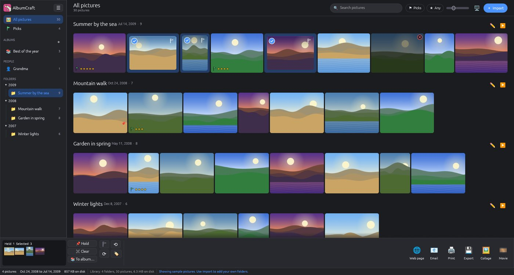
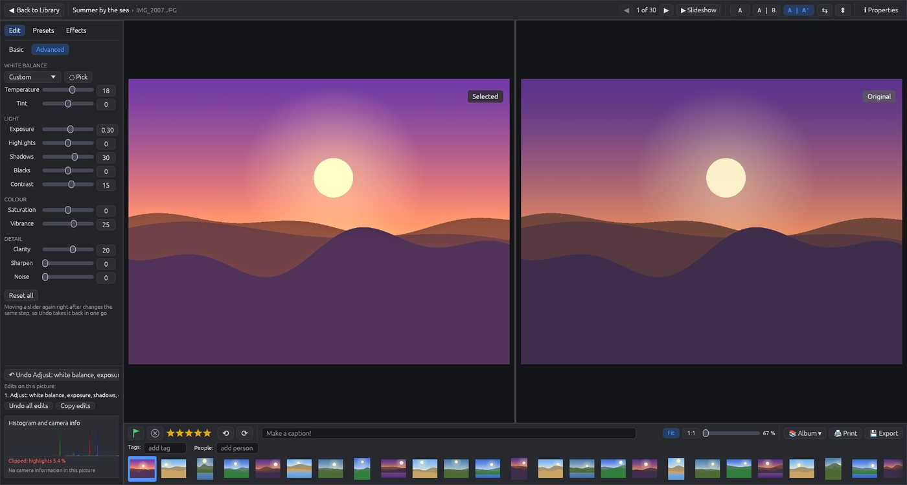
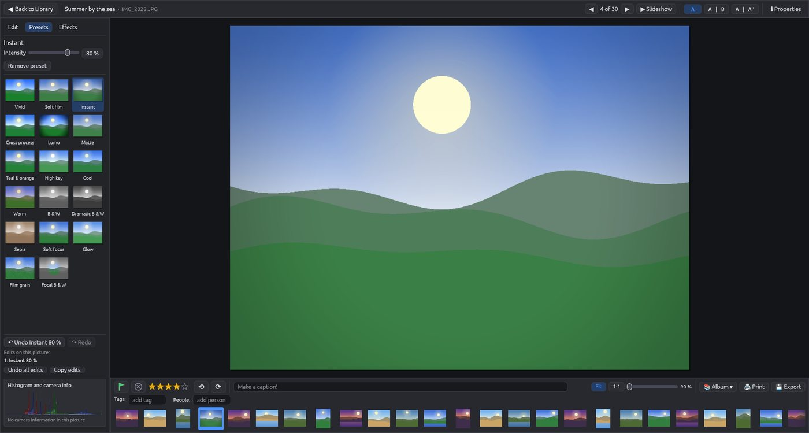
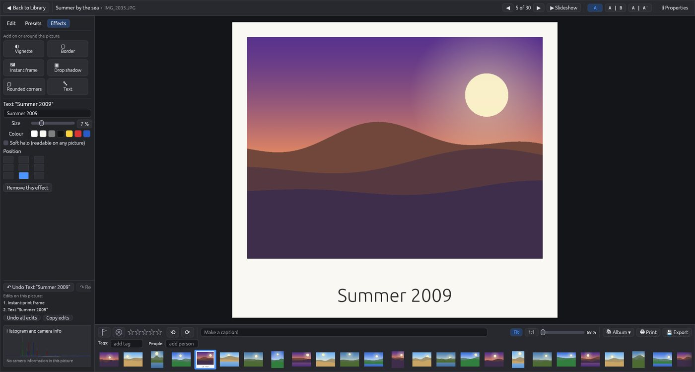

<p align="center"></p>

<h1 align="center">AlbumCraft</h1>

<p align="center">A fast, simple organizer for your photos and videos, with a non-destructive editor.<br>
Native Rust, for Linux, Windows and macOS. Part of the <i>Craft</i> apps family.<br>
In English, French, German, Spanish, Italian and Portuguese (Brazil).</p>

AlbumCraft is ready for everyday use. Development continues and new features arrive regularly, but what is there works.

**Your originals are safe.** Edits are kept apart from your files and applied only to the copies you export. Files are moved, renamed or deleted only when you ask, and deleted files go to the system's trash.



## Organize

- **Your folders, as they are.** Point AlbumCraft at your picture folders and it finds every photo and video. They are shown by folder, newest first, in a justified grid, sorted by file name, date taken or rating. Folders can be listed by year or as they are on disk. Large libraries on slow or external disks stay fast, and the library shows at once when the app starts.
- **Every common format:** JPEG, PNG, TIFF, WebP, GIF, BMP, HEIC (iPhone and Mac), AVIF, camera raw files (CR2, CR3, NEF, ARW, DNG, ORF, RW2, RAF, …, shown through the preview the camera embeds) and videos (MP4, MOV, MKV, AVI, WebM, MTS, …). Colour profiles are respected, so wide-gamut pictures look right.
- **Import** from a memory card, a camera or any folder. Pictures are grouped by time, those already in your library are left out, and the rest are copied into a new folder you name. Nothing is ever overwritten. (Adding a folder to the library copies nothing.)
- **Culling:** pick or reject, 1–5 stars, all from the keyboard in the grid and the editor (`P` pick, `X` reject, `U` clear, `0`–`5` stars). Rejected pictures can be sent to the trash in one go.
- **Captions, tags and people.** Tags can be nested (*Nature › Birds*) and renamed, merged or reorganized in the tag manager.
- **Dates:** correct the date taken of one picture or many, shift a whole set when the camera clock was wrong, or give scanned prints just a year or a month.
- **One search box** for everything: words in names and captions, tags, people, albums, folders and places, with suggestions as you type. Places are found by city, region or country, even for pictures that only have a GPS position.
- **Smart search** (optional AI pack, runs on your computer): find pictures by what they show ("beach at sunset"), or ask for *More like this* from any picture. AlbumCraft can also propose tags, learning from your own tags and a built-in vocabulary.
- **Albums**: drag pictures onto one. Select with the mouse, with a box or with the arrow keys.
- **File handling:** right-click a folder or a picture to rename it, move it (also to another disk), move it to the trash, open it in another program or give a folder a caption. Undo moves things back. Sub-folders can be left out of the library in *Settings → Folders*.
- **XMP:** stars, captions, tags, people and dates written by Lightroom, digiKam and other programs are read from XMP sidecars and embedded XMP. AlbumCraft writes its notes back to XMP when you ask it to. Notes from classic `.picasa.ini` files are brought in too (read only).
- **Places**: a map of where your pictures were taken, using the GPS from phones and cameras. Set the location of any picture by searching for a city or an address, by dropping a pin on the map, or from a GPX track recorded on a walk. Show a folder or an album on the map.
- **Info panel** in the editor: camera details, the full EXIF data, a small map and the picture's tags.

## Edit

Every edit is non-destructive: it is stored in the library and applied when a picture is shown or exported.

- **Basic**: I'm feeling lucky, auto exposure, auto colour, auto contrast and auto straighten. Crop, straighten, red-eye, white balance from a gray point, rotate.
- **Advanced**:
  - geometry: crop to a free or fixed shape, straighten, vertical and horizontal perspective, with an alignment grid while you adjust;
  - white balance: presets, temperature, tint;
  - tone and colour: exposure, highlights, shadows, blacks, contrast, saturation, vibrance;
  - detail: clarity, sharpening and noise reduction;
  - a live histogram with a clipping warning.
- **Presets**: 17 looks (vivid slide film, soft film, instant print, cross process, lomo, matte, teal & orange, high key, dramatic black & white, sepia, soft focus, …), each with an intensity slider.
- **Effects**: vignette, borders and an instant-print frame, drop shadow, rounded corners, text.
- **Undo** step by step, and go back to any step from the list. Hold **Original** (or `O`) to see the picture without your edits. Copy the edits of one picture and paste them onto many. Compare two pictures side by side.
- **Videos**: play them with sound, step frame by frame, choose the part to keep and the frame used as the thumbnail.

| Editing with the Advanced sliders | Presets | Effects |
|---|---|---|
|  |  |  |

## Share

- **Export** edited copies: any size and JPEG quality, a text or logo signature, creator and copyright, and optionally the camera information, the location and your notes.
- **Collages**: photo pile, mosaic, centre stage, grid, film strip, clothesline, fan, heart / circle / star, multiple exposure. Use a colour, gradient or picture background, and drag pictures to arrange them.
- **Contact sheets**: title, file names, several pages, PDF.
- **Prints**: Windows printing, or CUPS on Linux and macOS.
- **Slideshow**: full screen, with crossfades, slow pan and zoom, music and video clips. The editor also has a full-screen viewer (F11).
- **Email**: small copies attached to a new message in your mail program (Thunderbird, Evolution, KMail, Outlook, Apple Mail).
- **Web gallery**: a self-contained folder with an `index.html`, ready to open or upload anywhere. Choose from eight themes and a grid, column or justified layout. The animated lightbox supports swipe and zoom.
- **Slideshow movie**: an MP4 at 720p or 1080p, with looping music, made inside AlbumCraft with the bundled FFmpeg libraries, so nothing else needs to be installed.

## Use it from an AI agent (MCP)

`albumcraft --mcp` is a [Model Context Protocol](https://modelcontextprotocol.io) server on stdin/stdout. Its 54 tools let an agent do almost anything the window does:

- search the library, also by tag, place, position or what the pictures show;
- import pictures from a card or a folder;
- read a picture's details;
- flag, rate, caption, tag, date and locate pictures, and manage albums and tags;
- apply edits and one-click fixes, and render a preview;
- export, and make web galleries, movies, collages, contact sheets and emails;
- rename and move files and folders, or move them to the trash (only with a confirmation);
- show pictures in the editor or on the map.

```sh
claude mcp add albumcraft -- /path/to/albumcraft --mcp      # Claude Code
```

It works with or without the window open. While AlbumCraft is open, the tools act through the window and changes show at once. Otherwise they change the library file directly.

## Install

Download the build for your system from the [releases](https://github.com/kbarni/AlbumCraft/releases):

- **Windows**: the `.msi` installer, or the portable `-portable.zip` (unpack and run `albumcraft.exe`).
- **Linux** (Ubuntu 22.04, Debian 12 or newer; the Flatpak runs anywhere):
  - the `.deb` for Debian, Ubuntu and their relatives (`sudo apt install ./albumcraft-….deb`);
  - the `.flatpak` (`flatpak install --user albumcraft-….flatpak`);
  - the `.AppImage` (make it executable and run it);
  - the `.tar.gz` (unpack and run `albumcraft`; keep the libraries beside it).
- **macOS** (Apple Silicon, macOS 13.4 or newer): open the `.dmg` and drag `AlbumCraft.app` to Applications.

Everything the app needs comes with it. Video playback and movie export use *FFmpeg*, which is included.

The builds are not signed. On macOS, right-click the app and choose *Open* the first time. On Windows, choose *More info* → *Run anyway*.

AlbumCraft checks for new releases when it starts and offers to install them (see below).

## Build from source

You need a recent stable Rust (the toolchain file selects `stable`).

```sh
git clone https://github.com/kbarni/AlbumCraft.git
cd AlbumCraft
cargo run --release
```

On Linux, install the development headers first, e.g. on Debian/Ubuntu:

```sh
sudo apt install pkg-config libxkbcommon-dev libwayland-dev libx11-dev libxcb1-dev \
  libxcursor-dev libxrandr-dev libxi-dev libfontconfig1-dev libfreetype-dev libasound2-dev
```

Video support links a build of the FFmpeg libraries for playback and movie export (MPEG-4 and AAC encoders). Build it once with `packaging/ffmpeg/build.sh` (see `packaging/ffmpeg/README.md`), or build without videos: `cargo build --release --no-default-features --features onnx,heif,avif`.

`cargo test` runs the tests. `CLAUDE.md` and `AGENTS.md` describe the code and the rules for contributors (human or AI). `new_features.md` is the plan and its status.

## Where things are kept

- **The library** (notes, edits, albums, settings): `library.json` in the user data folder:
  - `~/.local/share/AlbumCraft` on Linux;
  - `%APPDATA%\AlbumCraft` on Windows;
  - `~/Library/Application Support/AlbumCraft` on macOS.

  You can move it to another folder in *Settings → Storage*. It is saved atomically. An unreadable library is kept aside, never overwritten.
- **Thumbnails**: a cache in the user cache folder (`AlbumCraft/thumbs`), kept under 2 GB. Safe to delete.
- **Map tiles** (online maps only): a cache in the user cache folder (`AlbumCraft/tiles`), kept under 500 MB. Safe to delete.
- **GPS positions** read from your pictures: `AlbumCraft/gps.json` in the same folder. Safe to delete.
- **Crash reports**: `crash.log` next to the library.

## Privacy

AlbumCraft makes no network connections except these:

- **Updates.** When it starts, AlbumCraft asks GitHub whether there is a newer release. Nothing else is sent. When there is one, it offers to download and install it, or to open the release page. Nothing is installed unless you say so. Turn the check off in *Settings → Interface → Updates*, or check by hand from the menu.
- **AI packs.** The packs for smart search and for faces are downloaded from the project's own releases, only when you ask for one in *Settings → AI features*. Pictures and search text never leave your computer.
- **Online maps**, if you turn them on. AlbumCraft asks once, at the first start; change it later in *Settings → Maps*. Then, and only while you use the map, it downloads map pictures from OpenStreetMap and sends the places you search for to OpenStreetMap's search service. Your pictures and their locations are never sent. Without online maps, the map and place search use the built-in world map and city list.

**Faces.** Finding and grouping the people in your pictures is off until you say yes (AlbumCraft asks once; change it in *Settings → AI features*). It happens on your computer only. A face is described by a list of numbers (a "vector"); these are biometric data, so they are kept only in the analysis folder (`AlbumCraft/analysis` in the user data folder), never in the library file, XMP sidecars, exported or emailed copies, web galleries or what the MCP server returns. What goes into the library file is what you decided: the names, the boxes you corrected or drew, and the pictures you said are not a person. Small pictures of faces shown in the window are kept in the thumbnail cache (`AlbumCraft/thumbs/faces`). *Settings → AI features → Delete all face data* (or the `delete_face_data` command) removes the faces found, their vectors, the groups and those small pictures, and turns faces off; your names and corrections stay.

The only listening socket is the local control connection the MCP server uses while the window is open. It accepts connections from 127.0.0.1 only and is protected by a token.

## License

AlbumCraft is licensed under either of

- Apache License, Version 2.0 ([LICENSE-APACHE](LICENSE-APACHE))
- MIT License ([LICENSE-MIT](LICENSE-MIT))

at your option. Bundled third-party material is listed in [NOTICE](NOTICE). Security issues:
see [SECURITY.md](SECURITY.md).

Unless you explicitly state otherwise, any contribution you intentionally submit for inclusion in
AlbumCraft, as defined in the Apache-2.0 license, shall be dual licensed as above, without any
additional terms or conditions.
