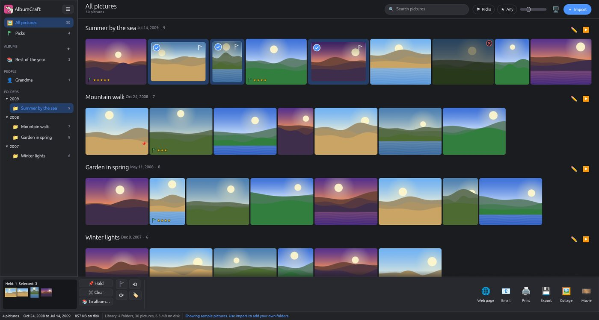
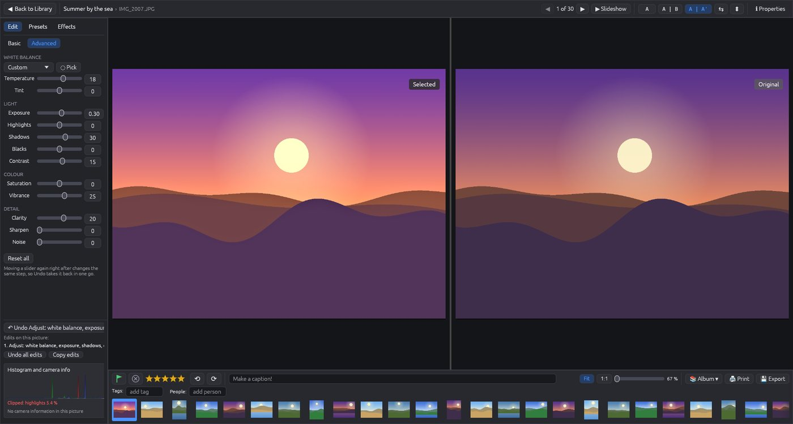
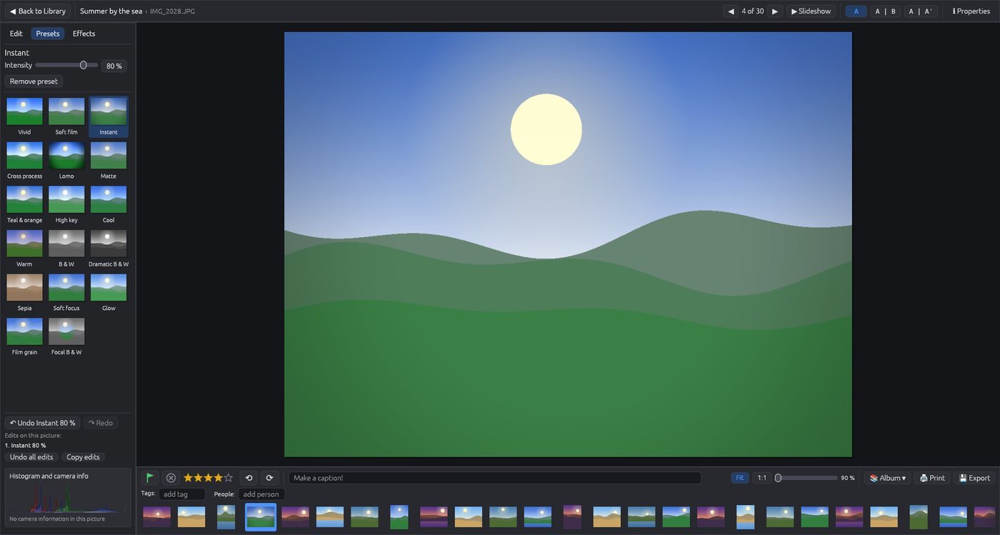
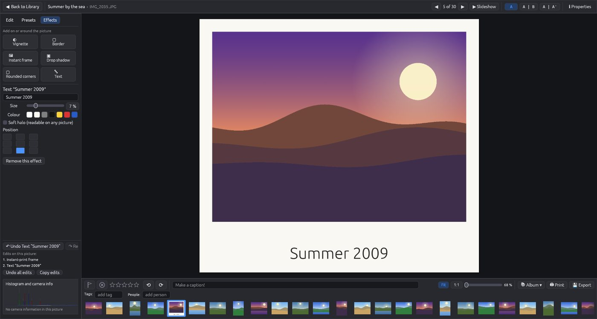

<p align="center"></p>

<h1 align="center">AlbumCraft</h1>

<p align="center">A fast, simple photo organizer with a non-destructive editor.<br>
Native Rust, for Linux, Windows and macOS. Part of the <i>Craft</i> apps family.</p>

> **Early version.** Expect rough edges and missing pieces.
> Your original pictures are never modified, so trying it is safe.



## What it does

**Organize**
- Point it at your picture folders; it finds every picture (JPEG, PNG, TIFF, WebP, GIF, BMP and camera raw files) and shows them by folder, newest first, in a justified grid.
- Pick or reject pictures, give them 1–5 stars, captions, tags and people; filter by any of those or search for words.
- Albums, a photo tray for collecting pictures across folders, and keyboard culling in the grid and the editor (`P` pick, `X` reject, `U` clear, `0`–`5` stars).
- Camera raw files (CR2, CR3, NEF, ARW, DNG, ORF, RW2, RAF, …) are shown through the full-size preview the camera embeds in them.
- Picture notes made with the classic per-folder `.picasa.ini` files are brought in (read only).
- **Places**: a map of where your pictures were taken (GPS from phones and cameras is read automatically). Set the location of any picture by searching a city or address or by dropping a pin on the map; exported copies carry it in their EXIF (optional).

**Edit** — always non-destructive: edits are stored in the library and applied when a picture is shown or exported.
- *Basic*: I'm feeling lucky, auto exposure, auto colour, auto contrast, auto straighten; crop, straighten, red-eye, white balance from a gray point, rotate.
- *Advanced*: white balance (presets, temperature, tint), exposure, highlights, shadows, blacks, contrast, saturation, vibrance, clarity, sharpening and noise reduction, with a live histogram and clipping warning.
- *Presets*: 17 looks (vivid slide film, soft film, instant print, cross process, lomo, matte, teal & orange, high key, dramatic black & white, sepia, soft focus, …), each with an intensity slider.
- *Effects*: vignette, borders and an instant-print frame, drop shadow, rounded corners, text.
- Copy the edits of one picture and paste them onto many; compare before and after side by side.

**Share**
- Export edited copies (any size, JPEG quality), collages, prints (Windows printing, or CUPS on Linux and macOS).
- Full-screen slideshow with crossfades, slow pan and zoom, and music.
- A web gallery: a self-contained folder with an `index.html` (three styles, lightbox), ready to open or upload anywhere.
- A slideshow movie (MP4, 720p or 1080p, with music) when [FFmpeg](https://ffmpeg.org/download.html) is installed.

| Editing with the Advanced sliders | Presets | Effects |
|---|---|---|
|  |  |  |

## Use it from an AI agent (MCP)

`albumcraft --mcp` is a [Model Context Protocol](https://modelcontextprotocol.io) server on
stdin/stdout. It offers 26 tools: search the library (also by location), read a picture's details,
flag, rate, caption, tag, manage albums, set or remove locations and look up places, apply edits
and one-click fixes, render a preview image, export, make a web gallery or a movie, and open a
picture in the window.

```sh
claude mcp add albumcraft -- /path/to/albumcraft --mcp      # Claude Code
```

It works with or without the window open. While AlbumCraft is open, the tools act through the
window (changes show at once); otherwise they change the library file directly.

## Install

Download the build for your system from the
[releases](https://github.com/kbarni/AlbumCraft/releases):

- **Windows**: the `.msi` installer, or the portable `.zip` (unpack and run `albumcraft.exe`).
- **Linux**: the `.deb` for Debian, Ubuntu and their relatives (`sudo apt install ./albumcraft-….deb`),
  the `.flatpak` (`flatpak install --user albumcraft-….flatpak`), the `.AppImage` (make it
  executable and run it) or the `.tar.gz` (unpack and run `albumcraft`).
- **macOS** (Apple Silicon): unpack the `.zip` and move `AlbumCraft.app` to Applications.

The builds are not signed: on macOS, right-click the app and choose *Open* the first time; on
Windows, choose *More info* → *Run anyway*.

Optional: [FFmpeg](https://ffmpeg.org/download.html) on the `PATH` for movie export.

## Build from source

You need a recent stable Rust (the toolchain file selects `stable`).

```sh
git clone https://github.com/kbarni/AlbumCraft.git
cd AlbumCraft
cargo run --release
```

On Linux, install the development headers first, e.g. on Debian/Ubuntu:

```sh
sudo apt install pkg-config libxkbcommon-dev libwayland-dev libx11-dev libxcb1-dev \
  libxcursor-dev libxrandr-dev libxi-dev libfontconfig1-dev libfreetype-dev libasound2-dev
```

`cargo test` runs the tests. `CLAUDE.md` and `AGENTS.md` describe the code and the rules for
contributors (human or AI); `new_features.md` is the plan and its status.

## Where things are kept

- The library (notes, edits, albums, settings): `library.json` in the user data folder
  (`~/.local/share/AlbumCraft` on Linux, `%APPDATA%\AlbumCraft` on Windows,
  `~/Library/Application Support/AlbumCraft` on macOS). It is saved atomically; an unreadable one
  is kept aside, never overwritten.
- Thumbnails: a cache in the user cache folder (`AlbumCraft/thumbs`), kept under 2 GB; safe to delete.
- Crash reports: `crash.log` next to the library.

- Map tiles (online maps only): a cache in the user cache folder (`AlbumCraft/tiles`), kept
  under 500 MB; GPS positions read from your pictures: `AlbumCraft/gps.json`. Both safe to delete.

AlbumCraft makes no network connections unless you turn on **online maps** (it asks once, at the
first start; change it later in the main menu, Tools › Online maps, or on the map). Then, and only
while you use the map, it downloads map pictures from OpenStreetMap and sends the places you
search for to OpenStreetMap's search service. Your pictures and their locations are never sent.
Without online maps, the map and place search use the built-in world map and city list.

The only listening socket is the local (127.0.0.1, token-protected) control connection the MCP
server uses while the window is open.

## License

AlbumCraft is licensed under either of

- Apache License, Version 2.0 ([LICENSE-APACHE](LICENSE-APACHE))
- MIT License ([LICENSE-MIT](LICENSE-MIT))

at your option. Bundled third-party material is listed in [NOTICE](NOTICE). Security issues:
see [SECURITY.md](SECURITY.md).

Unless you explicitly state otherwise, any contribution you intentionally submit for inclusion in
AlbumCraft, as defined in the Apache-2.0 license, shall be dual licensed as above, without any
additional terms or conditions.
